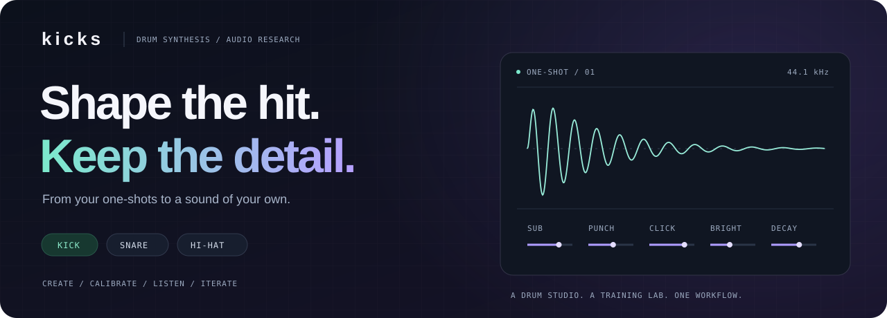

<p align="center">
  
</p>

# kicks

A local studio for synthesizing kicks, snares and hi-hats, exploring the sample
corpus, and comparing audio experiments. Play MIDI or keyboard pads, save kits
on your computer, and export 24-bit WAVs. The app opens directly into Studio;
Analysis is the second main workspace.

## Start the studio

Requirements: Python 3.10+, [uv](https://docs.astral.sh/uv/), Node 22+ and pnpm.

```bash
uv sync
uv run kicks serve --backend dsp
```

In another terminal:

```bash
cd web
cp .env.example .env.local
pnpm install
pnpm dev
```

Open [Studio](http://localhost:3000/) or [Analysis](http://localhost:3000/analysis/).
The API binds to `127.0.0.1:8080` by default. No account or external service is
needed. Kits autosave in this browser; named kits and JSON import/export make
it possible to keep several versions.

The **Synth** engine works without a corpus, checkpoint or model download.
Its physical controls show actual Hz, milliseconds and mix values. Decay is
specified as amplitude time to −60 dB; pitch time is an exponential time
constant. These are physical controls, not calibrated perceptual sliders.

| Voice | Synthesis | Presets |
|---|---|---|
| Kick | Integrated pitch envelope, sinusoidal body, beater transient and saturation | round, sub, punch, dry |
| Snare | Shell modes, independent wire-noise envelopes and stick attack | classic, tight, deep, rattle |
| Hi-hat | Inharmonic FM bank, shaped air and spectral/envelope motion | closed, open, pedal, metal |

The voices render at four times the output rate before downsampling. Seeded
noise preserves a texture during edits. Hi-hat pads share a choke group with a
short smooth release. Browser playback uses cached audio, so repeated pad hits
do not require another server render.

## Generate and reproduce a sound

```bash
uv run kicks dsp-presets -i kick
uv run kicks dsp-generate -i kick --preset punch -n 4 --seed 20 --out output/my-kicks
uv run kicks dsp-generate -i hihat --preset open --param decay_ms=700 --out output/my-hats
```

Each WAV has a JSON preset containing physical values, seed, sample contract,
renderer version and a content identity. Existing output files are not replaced.
Load it with `kicks.synthesis.procedural.Preset.load(path).audio()` to reproduce
its waveform in the same software environment.

To test sample-assisted texture, supply a local recording you can use:

```bash
uv run kicks dsp-generate -i snare --preset tight --texture /path/to/wire.wav \
  --texture-mix 0.2 --out output/snare-texture
```

The preset records the source path, source SHA-256 and mix. Replaying it refuses
changed texture bytes. This mixes recorded texture; it is not a trained neural
residual model.

## Compare experiments

The [research and implementation plan](docs/drum-generation-research-plan.md)
explains the framework choices, synthesis recipes and quality criteria.
The [implementation record](docs/studio-implementation-20261014.md) lists the
completed work, local audition files and measured pilot results.

```bash
uv run kicks benchmark-freeze --out output/benchmarks/corpus.json
uv run kicks benchmark-dsp -i kick --settings 24 --seeds 3 --out output/fidelity/dsp-kick
uv run kicks benchmark-dsp -i snare --settings 24 --seeds 3 --out output/fidelity/dsp-snare
uv run kicks benchmark-dsp -i hihat --settings 24 --seeds 3 --out output/fidelity/dsp-hihat
```

The frozen manifest hashes corpus bytes, preserves source-record identities,
groups exact duplicates and source packs, and records train/validation/test
membership. Optional `--groups labels.json` overrides inferred labels, keyed by
`corpus/filename` with `group`, `family`, `articulation` and `license` fields.
Unknown sources are conservatively grouped and assigned to training. Source
splits can leave an instrument/family missing from a fold; warnings remain in
the manifest. Filename labels need review and near duplicates need additional
inspection before a release-quality benchmark.

DSP benchmarks record every physical setting, audio/preset identity, final
waveform measurements and cold/warm rendering time. Their generation metrics
are separate from paired reconstruction errors and do not certify listening
quality. `benchmark-audio --generated DIRECTORY -i kick --out REPORT_DIRECTORY`
applies the same final-waveform checks to VAE, diffusion or external WAVs. It
requires the common 44.1 kHz mono, 65,536-sample contract. Optional raw descriptor
targets and explicitly paired reference files remain separate measurements.
To compare two runs made with the same conditions and seeds:

```bash
uv run kicks listening-compare --left output/fidelity/snare-dsp \
  --right output/fidelity/snare-hybrid --out output/fidelity/snare-ab
uv run kicks dashboard
```

The comparison produces randomized, level-matched full-band and high-band A/B
pairs in the existing Listening lab. Neither the comparison writer nor the
metric report invents listener judgments.

Fit a joint physical-parameter bank on the frozen **training fold**:

```bash
uv run kicks dsp-fit -i kick --manifest output/benchmarks/corpus.json \
  --count 8 --evaluations 64 --out models/experiments/kick-physical-bank.json
uv run kicks dsp-sample-bank --bank models/experiments/kick-physical-bank.json \
  --count 8 --out output/fitted-kicks
```

Fitting uses bounded optimization and true multi-window waveform magnitudes.
The bank samples joint fitted settings with bounded local variation; it is an
empirical parameter prior, not a neural network. Use `codec-audit --help` to
check a **local, matched 44.1 kHz DAC checkpoint** against a manifest's validation
or test fold before considering a codec prior. That tool does not download
weights or fall back to training data.

## Existing neural engines

The VAE learns a global latent representation of 128-band log-mels. Its
per-instrument defaults use DisCoder for kicks/snares and BigVGAN for hats.
Calibrated perceptual controls and waveform corrections remain available.
Optional waveform diffusion generates audio directly from descriptor conditioning.
The studio lists the engines available for each instrument.

```bash
uv run kicks serve --backend vae
uv run kicks serve --diffusion hihat=/path/to/diffusion_best.pth
```

`--backend auto` prefers a trained VAE, then an explicitly configured diffusion
checkpoint, then DSP. Choosing Synth in Studio does not promote or replace a
neural checkpoint. DSP is measured and testable here; an audio-quality winner
still requires blind listening.

Local samples belong in `data/kicks/`, `data/snares/`, and `data/hihats/`.
Keep `data/corpus_ids.json` and each corpus's `SOURCES.md`: they are the durable
source and license records after numeric renaming. Corpora and weights are not
tracked in Git. Analysis uses the checked-in browser-safe corpus summaries;
regenerate them with `uv run kicks publish-analysis` after local analysis work.

For training, begin with `uv run kicks dashboard`. Isolate candidate weights,
record the experiment brief, evaluate audio and controls, then decide whether
to promote. The neural pipeline's audio contract remains 44.1 kHz mono and
65,536 samples (about 1.486 seconds). Longer original recordings are retained.

- [Fidelity experiments and promotion](docs/high-fidelity-generation.md)
- [Snare and hi-hat identity controls](docs/audio-identity-plan.md)
- [Waveform diffusion design and historical measurements](docs/waveform-diffusion.md)
- [Optional Modal research training runbook](docs/modal-training.md)
- [Contributor and implementation contracts](CLAUDE.md)

## Development checks

```bash
uv run pytest -q
cd web
pnpm lint
pnpm test
pnpm build
```

The website builds as a static artifact. `pnpm dev` serves local development;
serve `web/out/` with a static file server to inspect a build. The API remains
a separate local process. Development and builds use Webpack, with system fonts
and no build-time font download.

The repository is MIT licensed. Imported sample assets and pretrained models
retain their own licenses. DisCoder's upstream attribution is included in
[kicks/nn/DISCODER_LICENSE](kicks/nn/DISCODER_LICENSE).
