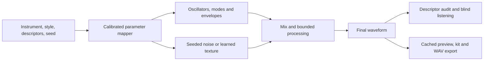

# Research and plan for kick, snare and hi-hat generation

Research date: **14 October 2026**. Scope: controllable, production-quality drum
one-shots for this repository's studio, with a possible browser or DAW instrument
later. This is a research-backed proposal; it does not report a new listening
test, model benchmark or training run. Numerical settings below are proposed
starting points and acceptance targets, not industry standards or measured wins.

Implementation followed this research on the same date. See the
[implementation record](studio-implementation-20261014.md) for completed features,
pilot measurements and the remaining listening and model gates. The proposals
below retain their research context; they are not all implemented or validated.

## Recommended direction

**Build an instrument-specific DSP baseline, then test a hybrid of DSP and
learned texture against the existing neural engines.** Keep PyTorch for research,
use Faust if a shared native/browser DSP implementation becomes necessary, and
use JUCE if a DAW plug-in becomes a product requirement.

The best approach depends on the intended sound:

| Goal | Recommended starting point | Main trade-off |
|---|---|---|
| Electronic kicks with precise pitch, punch and decay | Pitched oscillator/resonator, independent transient, controlled saturation | Excellent control; acoustic complexity needs additional texture |
| Electronic snares and flexible sound design | Several decaying modes plus separately shaped noise and attack | Body and wires are easy to shape; simple noise can sound generic |
| Electronic hi-hats | Inharmonic oscillator/FM bank plus filtered noise and articulation envelopes | Metallic character is controllable; aliasing and static tails need attention |
| Convincing acoustic drums and performance variation | Licensed recordings, velocity layers, alternate hits and articulation-aware playback | Strong fidelity baseline; playback and processing do not create wholly new recordings |
| Novel acoustic or heavily processed one-shots | Compare a learned texture hybrid with full-band waveform/codec generation | Greater potential variety; quality, control and compute must be measured |

These choices have production precedents. Roland documents the TR-909's use of
analog kick/snare voices and sampled hats/cymbals. Steinberg Backbone separates
tonal and noise components for independent editing. BATTERY supports velocity
mapping, round robin playback and hi-hat voice/choke groups. These establish
useful design patterns, not proof that our proposed hybrid will outperform a
neural generator. [Roland TR-909 history](https://www.roland.com/ca/promos/roland_tr-909/),
[Backbone decomposition](https://www.steinberg.help/r/backbone/1.6/en/halion/topics/backbone/backbone_decomposing_sounds_c.html),
[BATTERY manual](https://www.native-instruments.com/fileadmin/ni_media/downloads/manuals/BATTERY_4_Manual_15_12_2021.pdf).

## Frameworks and model families

There is no single standard framework spanning plug-ins, browser audio and
neural training. JUCE is a widely adopted commercial audio development framework;
Web Audio is a browser standard. The neural systems below are useful tooling and
research references, with different maturity and deployment constraints.

| Framework or system | What it provides | Decision for this project |
|---|---|---|
| **JUCE / C++** | Cross-platform application, audio/MIDI and VST3/AU/AAX infrastructure. Its published users include major audio companies. | Preferred future DAW shell. It does not choose or train the drum generator. Select a license for the pinned version before distribution. [JUCE](https://juce.com/), [current commercial EULA](https://juce.com/legal/juce-9-licence/) |
| **Faust** | A DSP language compiling to targets including C++, WebAssembly and LLVM, with wrappers for different hosts. | Best candidate for sharing a proven procedural voice across server/native/browser builds. Test exported behavior before committing to a port. [Faust](https://faust.grame.fr/) |
| **Web Audio / AudioWorklet; Tone.js** | Browser scheduling, playback and synthesis; AudioWorklet runs custom processing on the rendering thread. Tone supplies useful instrument prototypes. | Keep browser playback local. Use Tone for quick comparisons or Faust/WASM in an AudioWorklet for custom DSP. Avoid requiring a server render for every pad hit. [W3C Web Audio](https://www.w3.org/TR/webaudio/), [Tone instruments](https://tonejs.github.io/docs/) |
| **SuperCollider / Csound** | Established synthesis environments with extensive oscillators, filters and instrument-building facilities. | Useful for fast sound-design experiments and reference patches; introducing either as another production runtime is unnecessary initially. [SuperCollider](https://github.com/supercollider/supercollider), [Csound engine](https://csound.com/docs/manual/UsingDesign.html) |
| **Existing PyTorch stack + auraloss** | The repository already uses PyTorch, NumPy/SciPy and SoundFile. Auraloss supplies waveform multi-resolution STFT objectives. | Retain this stack for fitting and neural research; add dependencies only when an experiment requires them. Distinguish true multi-window waveform analysis from pooling one mel image. [Auraloss](https://github.com/csteinmetz1/auraloss) |
| **DDSP** | Differentiable oscillators, filters and other interpretable signal processors; the original library uses TensorFlow. | Adopt the method where helpful through small PyTorch modules; a TensorFlow migration is unnecessary. Harmonic-plus-noise defaults need adaptation for inharmonic percussion. [DDSP library](https://github.com/magenta/ddsp), [paper](https://arxiv.org/abs/2001.04643) |
| **Stable Audio 3 / stable-audio-tools** | Current pretrained latent audio generation and associated inference/training tooling. The Small SFX model supports variable-length generation and editing. | Benchmark **`stabilityai/stable-audio-3-small-sfx`** as an external text-to-sound candidate in an isolated environment. A prompt is not a calibrated timbre slider; measure single-hit success and onset placement. Model access and component terms are separate from the tools' MIT license. [Model card](https://huggingface.co/stabilityai/stable-audio-3-small-sfx), [tools](https://github.com/Stability-AI/stable-audio-tools) |
| **Descript Audio Codec (DAC)** | A pretrained waveform encoder/decoder, including native 44.1 kHz models; code and published weights are MIT licensed. | First codec to test for a custom latent-sequence generator. A codec compresses audio; it still needs a learned prior to generate new hits. [DAC](https://github.com/descriptinc/descript-audio-codec) |
| **RAVE** | Waveform autoencoding, streaming export and optional latent-prior training, with multiple model configurations. | Secondary candidate if fast neural decoding becomes central. Adapt the training window and evaluate transient handling; real-time export alone does not establish drum quality. [RAVE](https://github.com/acids-ircam/RAVE) |
| **AudioCraft / AudioGen / MusicGen** | PyTorch research tooling for general sound and music generation. Published code is MIT; published model weights are CC-BY-NC 4.0. | Useful references, lower priority for this commercial studio and precise one-shot controls. The repository currently documents an older PyTorch environment, so isolate any experiment. [AudioCraft](https://github.com/facebookresearch/audiocraft) |

Two particularly relevant research results:

- **DrumGAN** demonstrates drum generation conditioned on perceptual descriptors.
  Its published experiment used 16 kHz audio and a private corpus; the public
  repository warns it is not up to date. Borrow the conditioning/evaluation
  ideas rather than treating it as a ready full-band replacement.
  [Paper](https://arxiv.org/abs/2008.12073),
  [author examples and sample-rate details](https://sites.google.com/view/drumgan),
  [implementation](https://github.com/SonyCSLParis/DrumGAN).
- **NoiseBandNet** learns time-varying gains over noise bands for inharmonic sound
  effects. Its reported experiments concern effects such as footsteps, knocking
  and metal, so applying it to hats/snare wires is our proposed experiment.
  The reference implementation is AGPL-3.0; account for that if reusing code.
  [Paper](https://arxiv.org/abs/2307.08007),
  [implementation](https://github.com/adrianbarahona/noisebandnet).

For a new pretrained comparison, start with the current SFX-focused model above.
Stable Audio Open Small remains an older, smaller comparison if resource limits
justify it; its model card describes 44.1 kHz stereo generation up to 11 seconds.
Do not assume either model meets our controls or hardware budget from its demos.
[Open Small model card](https://huggingface.co/stabilityai/stable-audio-open-small/blob/main/README.md).

## How to synthesize each instrument

### Kick: control the pitch trajectory and attack separately

Start with a sine oscillator with a falling frequency envelope and a decaying
amplitude envelope. Add an independently enveloped beater/click layer, then
optional upper modes and saturation. A conceptual voice is:

```text
frequency(t) = base_frequency + pitch_drop * exp(-t / pitch_time)
phase[n] = phase[n-1] + 2*pi*frequency[n]/sample_rate
body = amplitude_envelope * sin(phase)
kick = output_stage(body + transient + optional_texture)
```

Integrate frequency to obtain phase; multiplying instantaneous frequency by
time produces the wrong sweep. Tone's MembraneSynth demonstrates the oscillator
and frequency-envelope pattern. Circuit modeling is a separate, more involved
route when authentic interaction between trigger, accent and resonance matters.
[Tone MembraneSynth](https://tonejs.github.io/docs/15.1.22/classes/MembraneSynth.html),
[TR-808 circuit-model paper, DAFx 2014](https://dafx.de/paper-archive/2014/dafx14_kurt_james_werner_a_physically_informed%2C_ci.pdf).

Proposed design priors: a 35–80 Hz settled fundamental for the first electronic
bank, pitch-settling times around 5–60 ms, and body durations around 80–800 ms.
These are restricted starting ranges, to extend for other styles. An exponential
time constant and an audible duration are different parameters; specify which
one a preset stores.

Make oscillator phase reproducible for a fixed seed, align layered transients,
and check low-frequency cancellation. Apply oversampling/anti-aliasing around
nonlinear processing. A tiny boundary fade must not erase the intended click.
For acoustic character, test a licensed beater/skin texture or a learned attack
layer. Map the existing Sub/Punch/Click/Bright/Decay descriptors to physical
parameters through calibration; they are not direct synonyms for those parameters.

### Snare: separate shell modes, attack and wire noise

Use a small bank of decaying resonant modes for the body, a short stick transient,
and independently filtered/enveloped noise for the wires. Give shell and wires
different decay and brightness trajectories. Plaits provides a concrete
implementation of modes mixed with shaped noise. Published DDSP work also
demonstrates timbral control of a TR-808-inspired snare synthesizer.
[Plaits snare source](https://github.com/pichenettes/eurorack/blob/master/plaits/dsp/drums/analog_snare_drum.h),
[snare timbre-remapping research](https://arxiv.org/abs/2407.04547).

Proposed initial body tuning: roughly 140–300 Hz, with higher resonances and
separate wire-duration presets. Electronic and acoustic families need different
mode structures; a fixed harmonic stack is a limited acoustic model.

Map Body to mode balance, Crack to attack contrast, Snap to wire/body balance,
Bright to the wire spectrum, and Decay to coordinated shell/wire envelopes.
Measure these mappings against the existing descriptor definitions. Use a fixed
noise seed during control sweeps, then audition alternate seeds for repeated hits.
If the wire tail sounds like static hiss, compare time-varying noise bands,
sampled wire texture and a learned texture model before increasing model size.

### Hi-hat: preserve inharmonic texture and articulation

For electronic hats, start with an inharmonic oscillator bank or ring/FM source,
band/high-pass shaping, a noise contribution, and a fast envelope with a shaped
tail. Plaits' hat voice offers six-square-oscillator and ring-modulated sources;
this is a useful inspectable reference. Filtered white noise alone is a useful
baseline but lacks much of that metallic structure.
[Plaits hi-hat source](https://github.com/pichenettes/eurorack/blob/master/plaits/dsp/drums/hi_hat.h).

Proposed audible-duration presets: approximately 20–150 ms closed and
150–1,200 ms open. Treat openness as an articulation affecting spectrum and
envelope as well as duration. Add a choke group so a closed hit can end an open
voice with a short smooth release. Test pedal and edge/bow variations later,
using explicit labels rather than assuming one continuous decay knob covers them.

For acoustic hats, prioritize a sample-based fidelity reference and the learned
waveform/codec comparison. Test high-frequency modulation and changing spectral
shape through the tail. Avoid a tonal fundamental score for unpitched hats;
oversampling or band-limiting must address oscillator/FM aliasing before it can
masquerade as useful high-frequency detail.

## Fit with the repository

The code currently defines 44.1 kHz mono audio with 65,536 samples, approximately
1.486 seconds, and a shared 128 × 256 mel representation. The VAE uses a global
latent representation; the generator fits a GMM prior. Profile defaults select
DisCoder for kicks/snares and BigVGAN for hats. The experimental waveform
diffusion engine has its own conditioned sampling path and API selection.
These are code observations, not a certification of the current checkpoints.

Relevant starting points are [audio constants](../kicks/audio/constants.py),
[instrument profiles](../kicks/instruments/),
[current generation](../kicks/synthesis/generator.py),
[diffusion sampling](../kicks/synthesis/diffusion.py), and
[API state](../kicks/api/state.py).

Reuse the existing tracking, Listening lab and descriptor infrastructure.
The [fidelity plan](high-fidelity-generation.md) still supplies the VAE ablation
sequence. The [diffusion notes](waveform-diffusion.md) contain historical runs
and costs; inspect actual artifacts before making a current quality claim.
Some older prose calls diffusion untrained or unavailable in the studio,
whereas current API code supports optional experimental serving.

The current `kicks fidelity` and `scripts/validate_controls.py` paths are
VAE-specific. A common benchmark adapter is required before applying their
workflow to DSP, hybrid or diffusion output. Existing promotion is also
VAE-oriented; serving an experimental engine and promoting it are different steps.

For the first comparison, retain the existing audio contract. Audit how many
reference tails it truncates, especially open hats and long kicks. Any longer
window, stereo or native 48 kHz path needs its own representation/checkpoint
version. Resampling an output does not restore detail lost during training.

Proposed hybrid architecture:



First learn a distribution of useful physical parameters or a small mapper;
only then test learned texture. Parameter fitting can have multiple equally
valid solutions, so score the resulting audio and regularize to sensible ranges.
A learned residual requires an explicit decomposition/alignment strategy:
subtracting an arbitrary synthesized waveform from a recording does not reliably
isolate its noise texture.

## Implementation sequence and decision gates

The first three stages are the priority. Later stages depend on their evidence;
the plan does not require every framework to become a dependency.

| Stage | Work and deliverable | Gate to continue |
|---|---|---|
| **0. Freeze the benchmark** | Inventory corpus identities/licenses and checkpoint hashes. Label acoustic/electronic families and closed/open hats. Group related packs, duplicate variants and recordings before splitting. Save a versioned manifest and evaluation specification. | Train/validation/test groups and descriptor ranges are fixed; missing provenance is recorded. |
| **1. Establish baselines** | Render the existing per-instrument VAE path; run reference → real-mel vocoder → VAE reconstruction diagnostics separately. Evaluate any chosen existing diffusion checkpoint as generation. Add a simple DSP voice and a licensed sample-playback reference. | Blind pilot identifies audible failure categories; generation latency, control error and rejection rates have comparable definitions. |
| **2. Build procedural voices** | Implement kick first, snare second, hat third. Create versioned physical parameter schemas, seeded renderers and curated preset banks. Reuse profile descriptor functions and calibrate their mapping to physical parameters. | Each voice produces stable one-shots, useful continuous controls and repeatable renders without severe artifacts. |
| **3. Fit and test the hybrid** | Fit bounded parameter distributions to training audio. Compare DSP alone, DSP plus recorded texture, and a small learned noise/attack branch where the pilot found a limitation. Change one component per experiment. | The extra branch wins on blind usefulness/quality or supplies a documented capability at acceptable latency; otherwise keep DSP alone. |
| **4. Test a higher neural ceiling** | Benchmark Stable Audio 3 Small SFX without fine-tuning first. Test a matched DAC encode/decode round trip; only if that ceiling is adequate, train a small descriptor-conditioned latent-sequence prior. Compare with the existing waveform diffusion candidate. | Better quality/diversity survives control, cost and novelty checks; the result beats the simpler viable candidate for the intended family. |
| **5. Integrate the selected engine** | Add explicit backend/config identities and common evaluation adapters. Cache generation for pads. Attach evidence to runs and extend promotion to verify the exact renderer/checkpoint/config being adopted. Port proven DSP to Faust/WASM or JUCE only when the product requires it. | Preview/export agree; repeatability and rollback work; the chosen engine passes the declared release criteria. |

Stage 0 details:

- Preserve `data/corpus_ids.json` and local `SOURCES.md` records. Add content hashes
  and source-family groups to the experiment manifest; the existing path/size/mtime
  split fingerprint alone cannot prevent pack leakage.
- Split before augmentation. Keep alternate velocities, processed variants and
  alternate hits from the same source together. Fit descriptor scalers, priors
  and control ranges on training data only.
- Retain original recordings; version onset alignment, resampling, normalization,
  silence padding and tail handling. Short-hit loudness matching should combine
  active-region energy, peak headroom and listening checks; one integrated-LUFS
  number is not enough to equalize very short hats.

Stage 2 implementation details:

- Start the offline renderer in the current Python stack. Use PyTorch for parts
  that require gradients; keep lightweight waveform metrics independent of model
  imports. A second runtime or a native rewrite is contingent on profiling.
- Store units, constraints, envelope conventions, renderer version and random
  seed in presets. Separate a texture seed from descriptor settings and any
  performance variation seed. Promise repeatability within a specified software
  and device configuration, not bit identity across all accelerators.
- Add focused tests for sweep/phase calculation, timing, finite/bounded output,
  determinism, articulation/choke transitions and render/export consistency.
  Listening determines whether a correct renderer is musically useful.

Stage 3 training details:

- Begin with parameter fitting or a compact descriptor-to-parameter network;
  use multiple initializations where the inverse problem is ambiguous.
- For paired analysis/resynthesis, test waveform STFT windows such as
  128/512/2,048/8,192 samples, plus onset/envelope and descriptor objectives.
  Weight active attacks and tails separately. Record the choices and ablate them.
- Avoid forcing sample-wise waveform equality for independently drawn noise.
  Test band energy, spectral shape and temporal modulation for stochastic texture.
  Adversarial training is a later experiment if these objectives leave audible
  deficiencies, with its extra instability and compute recorded.
- Use joint, corpus-supported descriptor settings. Independently sampling every
  slider can request impossible combinations. Report limited reach instead of
  concealing it with aggressive equalization or gating.

Stage 4 details:

- Pin pretrained model revision, inference library, sample rate, prompt, sampler,
  steps and seed. Record failed generations and all candidate selection, including
  how many outputs were discarded to obtain one usable hit.
- Stable Audio's model card describes gated access and additional component
  terms. Verify training, commercial deployment and sample-export terms for the
  exact selected artifacts before incorporating them. No model access terms
  were accepted as part of this research.
- For a custom codec generator, keep the encoder/decoder pair matched. The
  project's DisCoder decoder is fine-tuned and is not automatically compatible
  with stock DAC encoder latents; establish that separately if considering it.
  See the existing [codec proposal](high-fidelity-generation.md#higher-ceiling-generate-an-audio-codec-latent-sequence).
- Cache latents and freeze the codec for the first prior experiment. Compare
  quality against compute at several sampler step counts. Increase dataset/model
  size only after a small pilot demonstrates learning and acceptable reconstruction.
- Profile on actual target hardware. Keep GPU experiments isolated, record memory
  and wall time, and set a compute budget from a measured pilot. Follow the
  project's existing training-phase and cloud-review workflow when executing it.

## How to decide what is best

Use three separate evaluations. **Reconstruction** compares a reference with
its encode/decode or fitted resynthesis. **Fresh generation** compares quality,
diversity and adherence at feasible targets. **Performance playback** tests
repetition, velocity and choke behavior. A good result in one does not prove the
others.

Do not calculate a paired reconstruction error between an arbitrary generated
drum and an unrelated reference waveform. Fresh hits can be equally valid while
having different phase and noise. Use target descriptors, distributions and
listening for that comparison.

| Dimension | Measurement |
|---|---|
| Attack and event integrity | Onset error for paired audio; requested onset for fresh hits; pre-onset energy; extra-event, silence and click counts |
| Kick identity | Settled fundamental, pitch trajectory, low-band envelope, transient/body balance and layer cancellation |
| Snare identity | Mode/body spectrum, attack contrast, wire/body balance and time-varying wire tail |
| Hat identity | Closed/open duration, inharmonic/noise balance, 2–8/8–16 kHz envelopes, modulation, metallic ringing and choke quality |
| Fidelity | Paired multi-window spectral/envelope errors plus blind whole-hit and high-band listening; raw and processed renders both retained |
| Controls | Axis, feasible-corner and random-target probes across fixed texture seeds; normalized target error, unintended descriptor movement and unreachable targets |
| Variety | Coverage within each family; nearest training-neighbor checks using more than one representation; human inspection of suspicious similarities |
| Product cost | Cold load, warm render p50/p95, memory, export time and rejected candidates per accepted sound; include control correction and sample selection |

Proposed first evaluation set: **24 feasible target settings per instrument,
three texture seeds each**, balanced across the intended families and hat
articulations. Use the same targets and selection budget for compatible engines.
Evaluate prompt-only models on a separately disclosed prompt mapping; they do
not receive credit for unsupported numerical conditioning. Compare methods at
both equal output count and equal compute/selection budget where practical.

Run an initial listening pilot with the owner to refine the rubric. For a
release decision, randomize and level-match a stratified subset of at least
24 comparisons per instrument, with five listeners if available. Rate quality,
instrument identity, usefulness and artifact rejection. Audition isolated hits
and short fixed patterns. Keep ties and rejected pairs; preserve the blind key
and verdicts. Report uncertainty clustered by target and listener, and collect
more judgments when the result is inconclusive.

Proposed release targets, to freeze after the pilot and before final evaluation:

- **Quality:** at least 60% preference among non-tied judgments over the relevant
  existing generator, with a clustered 95% confidence interval supporting a real
  preference, and no material increase in artifact rejection. With too few
  independent targets/listeners, label the finding preliminary.
- **Controls:** median absolute error no more than 10% of each descriptor's
  training-set 5th–95th percentile span, and no regression greater than five
  percentage points versus the baseline. Inspect p95 errors and coupled axes
  separately; exclude zero-span descriptors and disclose unsupported targets.
- **Robustness:** zero NaNs, clipping violations or reproducibility failures
  across the fixed 72-render set per instrument. Publish extra-event and unwanted
  tail rates separately, with family-specific tolerances agreed in the pilot.
- **Responsiveness:** initially target warm DSP render p95 below 100 ms for the
  current window on the target machine. Treat this as an offline render target;
  local cached pad playback must meet its audio scheduling deadline independently.
  Slower neural generation can be acceptable behind a deliberate Generate action.
- **Traceability:** retain the exact model/config/data identities, listening
  results, control reports, known limitations and rollback artifact for each
  instrument/backend decision.

Choose the winner **per instrument and sound family**. If procedural kicks win,
sample-based acoustic hats remain the strongest fidelity reference, and neural
snares win on novel texture, the engine registry should support that result.
The immediate next deliverable is the frozen benchmark plus a kick DSP proof
of concept, followed by snare and hat voices under the same evaluation contract.
